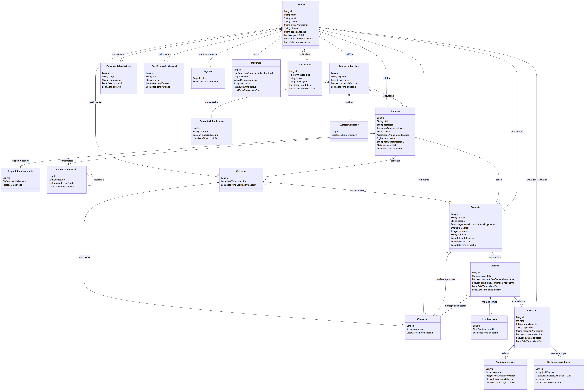
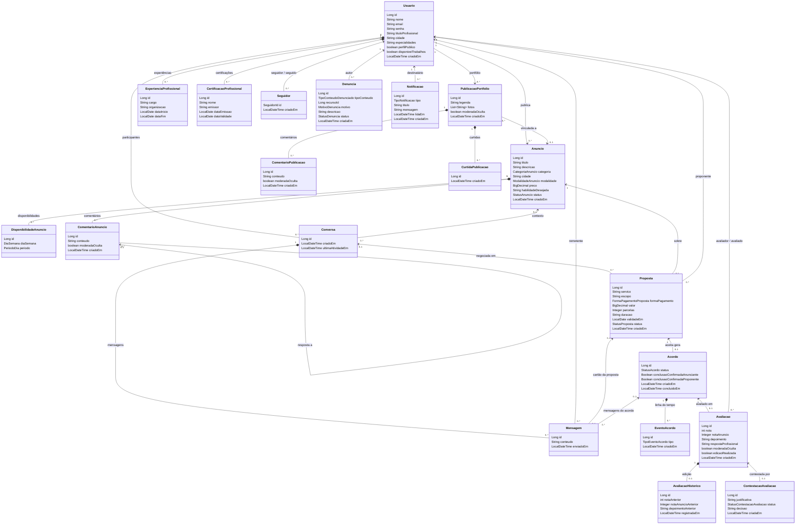

# Modelo de dados — diagrama de classes

Diagrama de classes das entidades JPA do SkillSwap, persistidas em MySQL pelas migrações Flyway de `backend/src/main/resources/db/migration`.

- Imagem: [modelo-dados.png](modelo-dados.png)
- Fonte editável (Mermaid): [modelo-dados.mmd](modelo-dados.mmd). O GitHub também desenha o diagrama diretamente a partir do bloco abaixo.

Legenda: seta (`-->`) indica associação `@ManyToOne`/`@OneToOne` com a multiplicidade de cada lado; losango preenchido (`*--`) indica composição, isto é, a parte não existe sem o todo (ex.: disponibilidades de um anúncio, eventos de um acordo).

## Como as entidades se relacionam

| Grupo | Entidades | Relações principais |
| --- | --- | --- |
| Conta e perfil profissional | `Usuario`, `ExperienciaProfissional`, `CertificacaoProfissional`, `Seguidor` | Um usuário tem várias experiências e certificações; `Seguidor` liga dois usuários (chave composta `SeguidorId`) |
| Oferta | `Anuncio`, `DisponibilidadeAnuncio`, `ComentarioAnuncio` | O anúncio pertence a um usuário, tem dias/períodos disponíveis e comentários com uma resposta por comentário |
| Negociação (funcionalidade do PI) | `Conversa`, `Mensagem`, `Proposta`, `Acordo`, `EventoAcordo` | A conversa é única por par de usuários; a proposta é feita sobre um anúncio dentro da conversa; o aceite gera um acordo, que registra eventos até a conclusão |
| Reputação | `Avaliacao`, `AvaliacaoHistorico`, `ContestacaoAvaliacao` | Uma avaliação por acordo concluído (cliente → profissional), com a versão anterior guardada se editada e no máximo uma contestação |
| Portfólio | `PublicacaoPortfolio`, `ComentarioPublicacao`, `CurtidaPublicacao` | Publicações do usuário, opcionalmente ligadas a um anúncio, com comentários e curtidas |
| Moderação e avisos | `Denuncia`, `Notificacao` | A denúncia aponta para o conteúdo por tipo + id (publicação, avaliação ou comentário); a notificação tem um destinatário |

## Enumerações usadas

| Enum | Valores |
| --- | --- |
| `ModalidadeAnuncio` | `VENDA`, `TROCA` |
| `StatusAnuncio` | `ATIVO`, `INATIVO` |
| `FormaPagamentoProposta` | `A_VISTA`, `PARCELADO`, `POR_HORA`, `POR_DIA`, `ASSINATURA`, `TROCA` |
| `StatusProposta` | `PENDENTE`, `ACEITA`, `RECUSADA`, `CANCELADA` |
| `StatusAcordo` | `EM_ANDAMENTO`, `CONCLUIDO`, `CANCELADO` |
| `StatusDenuncia` | `ABERTA`, `OCULTADA`, `DESCARTADA`, `REEXIBIDA` |
| `StatusContestacaoAvaliacao` | `ABERTA`, `MANTIDA`, `OCULTADA` |

Entidades de infraestrutura que não fazem parte do domínio e ficaram fora do diagrama: `SessaoPersistente` (sessões de login), `UploadUsuario` (cota de arquivos enviados) e `ItemVitrine` (conteúdo da página inicial).

